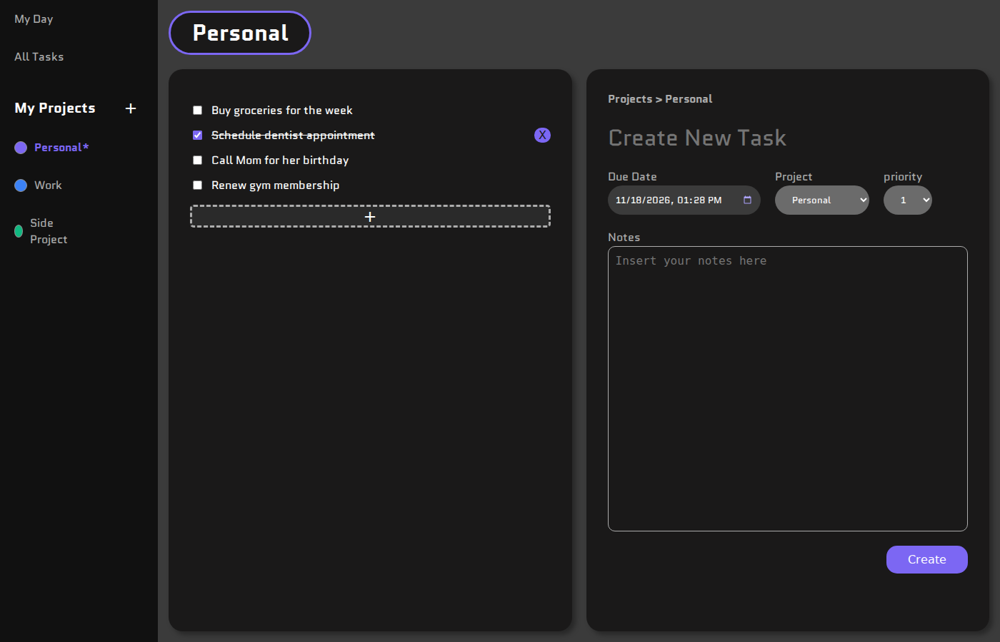

# Todo List

> A modular JavaScript task manager with projects, priorities, due dates, and localStorage persistence.

**JavaScript · Webpack · HTML · CSS**

**[Live Demo](https://hunterflechsig.github.io/odin-todo-list/)**



## Features

- Create, edit, and delete tasks with titles, descriptions, due dates, and priority levels
- Organize tasks into color-coded projects
- View tasks by project, due today ("My Day"), or all at once
- Mark tasks complete with strikethrough and delete option
- Set a default project (starred, pinned to top)
- Persist all data in the browser via localStorage

## How It's Built

The application separates data, presentation, and control into distinct ES modules:

- **Data classes** (`dataClasses.js`) define `Todo`, `Project`, and `AppData` with full JSON serialization for localStorage round-tripping
- **Storage** (`data.js`) wraps localStorage — loads existing state on startup or initializes defaults
- **View components** (`components/`) build DOM elements from data using `document.createElement` — no framework, no innerHTML
- **Controllers** (`index.js`, `controllers/`) handle user events via delegation on `data-action` attributes, update state, persist, and re-render

## Project Structure

```
src/
├── index.js              # App entry — SideBarController, AppController
├── index.html
├── components/
│   ├── main.js           # Project view, todo list, task form
│   ├── sidebar.js        # Sidebar project list
│   ├── lists.js          # My Day and All Tasks views
│   └── modals.js         # Project create/edit/delete dialogs
├── controllers/
│   ├── dataClasses.js    # Todo, Project, AppData models
│   ├── data.js           # localStorage persistence
│   ├── main.js           # Main content event handling
│   ├── modal.js          # Modal dialog logic
│   └── utilities.js      # DOM and form helpers
└── styles/
    ├── styles.css        # Layout, content area, form styling
    ├── sidebar.css       # Sidebar navigation
    └── modal.css         # Dialog styling
```

## Running Locally

```bash
npm install
npm start        # dev server at localhost:8080
npm run build    # production bundle → dist/
```

## Project Context

Built as part of [The Odin Project](https://www.theodinproject.com/lessons/node-path-javascript-todo-list) curriculum to practice modular JavaScript, DOM manipulation, and application state management with Webpack bundling.
